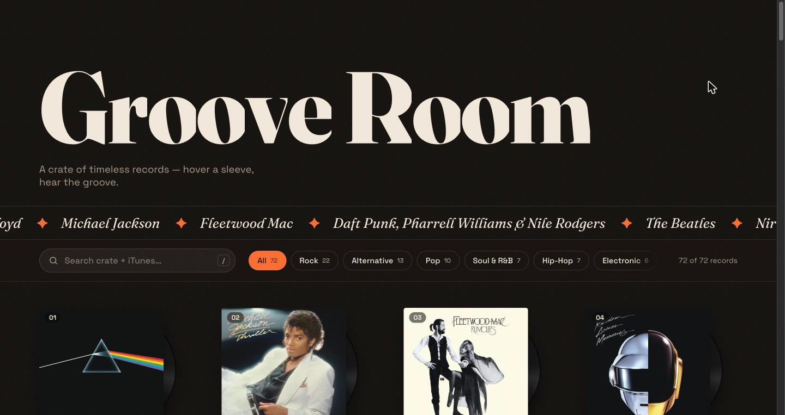
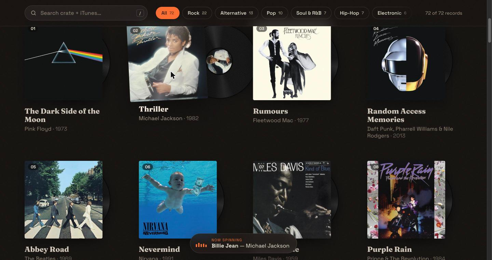
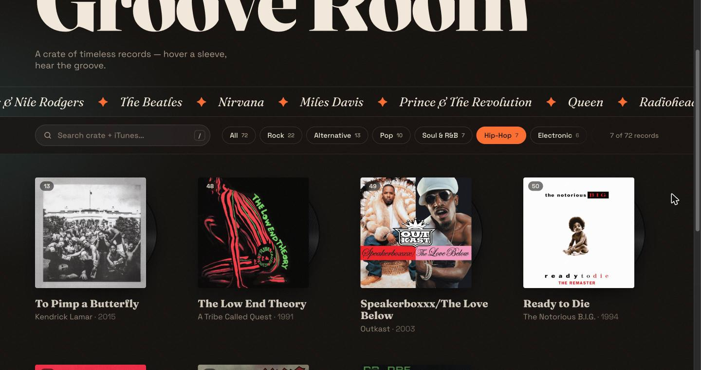
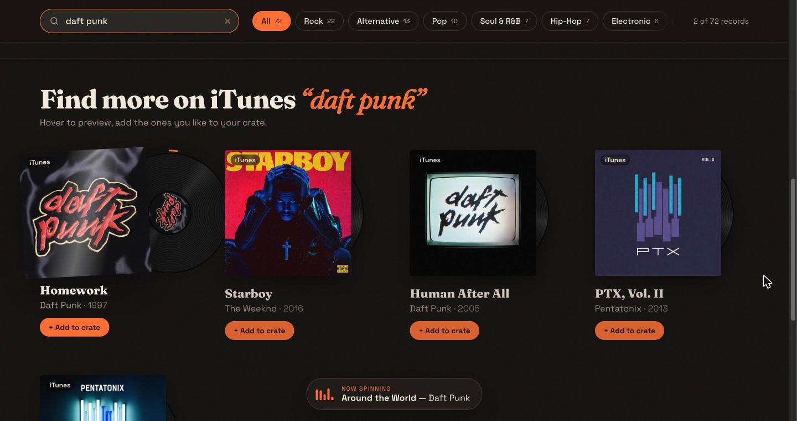
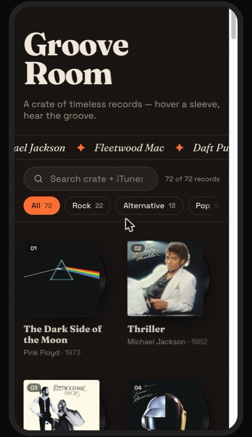

# Groove Room

A vinyl record crate in the browser. Hover a sleeve and the record slides out, spins up and plays a 30-second preview of a song from that album.

**Live site:** https://datodia.github.io/Groove-Mood/



## Features

### Hover to play

Each album is a sleeve with a record inside. On hover the sleeve tilts away, the record slides out and spins up like a turntable motor, and the song preview fades in. An orange ring around the record shows how far the preview has played, and a "Now spinning" bar shows the current track. On phones, tap a record to play it and tap again to stop.



### Search and genre filters

The search box matches artist, album, song, year and genre, and ignores accents ("bjork" finds Björk). Genre buttons show how many records each shelf holds. When the filter changes, cards animate to their new places.

Press `/` to jump to the search box and `Esc` to clear it.



### Find new songs on iTunes

Type at least two letters and the site also searches the iTunes catalog. Results appear as vinyl cards you can preview. Click **+ Add to crate** to add one to your collection. Added songs are saved in your browser, so they survive a reload but are not shared with other people.



### Works on phones

The grid switches to two columns, the toolbar compacts, and hover becomes tap.



## About sound

Browsers block audio until you click or press a key on the page once, and hovering does not count. Until then, hovering a record shows a hint to click anywhere to turn sound on. On phones the first tap unlocks sound.

## Tech

- [React](https://react.dev) and [Vite](https://vite.dev)
- [GSAP](https://gsap.com): timelines for the record animations, ScrollTrigger for the scroll-in reveal, Flip for the filter animation
- [iTunes Search API](https://performance-partners.apple.com/search-api) for album art, 30-second previews and live search

The 72 albums that ship with the site are in [`src/albums.json`](src/albums.json). Each entry has an `id`, `artist`, `album`, `track`, `year`, `genre`, `cover` and `preview` URL.

## Run it locally

```bash
npm install
npm run dev
```

Then open http://localhost:5173.

To test the production build the way GitHub Pages serves it:

```bash
npm run build
npm run preview
```

Then open http://localhost:4173/Groove-Mood/.

## Deployment

Every push to `main` runs [`.github/workflows/deploy.yml`](.github/workflows/deploy.yml), which builds the site and publishes the `dist` folder to GitHub Pages. The Vite `base` is set to `/Groove-Mood/` for builds in [`vite.config.js`](vite.config.js), matching the repository name. If you rename the repository, update that path.

## Credits

Album artwork and song previews are provided by Apple through the iTunes Search API and belong to their respective rights holders. This is a non-commercial learning project.
